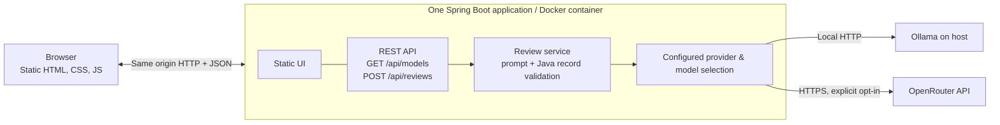

# StoryCheck AI

> **Turn a user story into a clearer, testable starting point.**

[](LICENSE)


**StoryCheck AI** is a small, self-hosted **user story review demo** planned with Java, Spring Boot, and Spring AI. Paste a story, choose a configured Ollama or OpenRouter model, and request suggestions for **acceptance criteria**, **clarification questions**, and **test cases**. Review the result on one page and copy it as Markdown.

> **Repository status: documentation-only baseline.** Release 0.1 is **Planned**. There is no application source, Maven project, runnable UI, or Compose stack yet. The diagrams, API paths, and commands below describe the target design, not shipped behavior. Implementation requires explicit story-by-story approval.

## Planned features — Release 0.1

- **One-page review:** paste a user story or concise requirement; view a structured review and copy Markdown.
- **Explicit model selection:** at most **three Ollama** and **three OpenRouter** models configured in `.env`; blank slots are hidden.
- **Two AI providers:** host-installed Ollama by default, optional OpenRouter via a server-side API key; never silently fall back to a paid provider.
- **Structured output:** the same Java record/JSON response contract for either provider, validated before returning it to the browser.
- **Small deployment:** one Spring Boot application serves the HTML/CSS/JavaScript UI and REST API; no separate frontend build, database, or application-side agent framework.

## Planned user journey

1. Open the StoryCheck AI page.
2. Select one of the configured models (Ollama or OpenRouter).
3. Paste a story, then click **Analyze Story**.
4. Read the proposed acceptance criteria, clarification questions, test cases and brief feedback.
5. Use **Copy Markdown** to paste the result into a ticket or repository story. Nothing is saved automatically.

```mermaid
sequenceDiagram
    actor User
    participant UI as Browser (HTML/JS)
    participant API as Spring Boot REST API
    participant AI as Spring AI ChatClient
    participant Provider as Selected Ollama / OpenRouter model
    User->>UI: Select model and paste story
    UI->>API: POST /api/reviews
    API->>API: Validate story and configured model
    API->>AI: Shared prompt + structured response schema
    AI->>Provider: Model request
    Provider-->>AI: Generated response
    AI-->>API: Parsed Java record
    API->>API: Validate result and limits
    API-->>UI: Structured review JSON
    UI-->>User: Show review; Copy Markdown
```

## Planned architecture



No database or shared Docker volume is needed. Ollama remains outside Compose; OpenRouter is a cloud API and may charge for usage. The user's story is sent to the **selected** model provider: use fictional or non-confidential material when testing external models.

More detail: [Architecture](docs/architecture.md) · [API contract](docs/api-contract.md) · [Model configuration](docs/model-configuration.md).

## Planned tech stack

| Layer | Technology |
| --- | --- |
| Application | Java 21, Spring Boot, Spring Web MVC |
| AI integration | Spring AI `ChatClient`, Ollama, OpenRouter (OpenAI-compatible endpoint) |
| Output | Java records, Structured Outputs / JSON Schema, server-side validation |
| UI | HTML5, CSS3, Vanilla JavaScript (`src/main/resources/static/`) |
| Build & tests | Maven, JUnit 5, Mockito, Spring MockMvc |
| Packaging | Docker, Docker Compose (one app service; external AI providers) |
| Quality | GitHub Actions (focused, mocked tests and build) |

Compatible Spring Boot and Spring AI versions will be selected and pinned in **STC-001**, not guessed in this documentation-only baseline. Compatibility of structured output is model-dependent and must be tested against the configured models.

## Model configuration (planned)

The example configuration exposes only non-empty allowlisted model slots:

```dotenv
OLLAMA_BASE_URL=http://host.docker.internal:11434
OLLAMA_MODEL_1=qwen2.5:7b
OLLAMA_MODEL_2=llama3.2:3b
OLLAMA_MODEL_3=

OPENROUTER_API_KEY=
OPENROUTER_MODEL_1=
OPENROUTER_MODEL_2=
OPENROUTER_MODEL_3=
```

These are **example model identifiers, not automatically installed models**. Set Ollama model names to models already pulled on your host. Enable OpenRouter only by providing a server-side API key and one or more compatible model IDs. The UI never receives the key. Model names are backend-validated; arbitrary client-supplied model IDs and automatic cloud fallback are not allowed.

Copy `.env.example` to `.env` once implementation exists; the file is included now as a non-secret configuration contract. See [Model configuration](docs/model-configuration.md) for container connectivity, empty slots, timeouts, and costs.

## Planned local startup (after STC-001–004)

Prerequisites: Java 21 + Maven or Docker/Compose. Ollama is needed only when using a local model; OpenRouter requires a compatible model ID and API key.

```bash
cp .env.example .env
# Edit model slots and credentials as needed.
docker compose up --build
```

Open `http://localhost:8080` after the Compose stack exists. **These commands will not start an application in this baseline**: STC-001 will create `pom.xml`, the Spring Boot project, and Docker/Compose files; STC-004 will finish the browser UI. Do not publish the demo openly with an unrestricted paid API key.

## Development workflow

The repo uses lightweight **story-driven AI-assisted development**. Read [AGENTS.md](AGENTS.md) and [Story workflow](docs/story-workflow.md), then implement **one approved** story at a time. Codex configuration has one **optional** `implementation_worker` and two technology-specific skills; no default parallel agents.

| Guide | Purpose |
| --- | --- |
| [Architecture](docs/architecture.md) | Boundaries and Mermaid diagrams |
| [API contract](docs/api-contract.md) | Planned endpoints and response shape |
| [Model configuration](docs/model-configuration.md) | Environment variables, provider selection, secrets |
| [Testing](docs/testing.md) | Focused checks and approved real-model smoke tests |
| [Roadmap](docs/roadmap.md) | Single planned release and story links |
| [Release 0.1](docs/releases/release-0.1-mvp/README.md) | STC-001–004 and acceptance criteria |
| [Verification](docs/releases/release-0.1-mvp/verification.md) | Actual results once implementation starts |
| [Future ideas](docs/future.md) | Optional possibilities, not planned stories |
| [Codex roles & skills](.codex/README.md) | Minimal agent/skill selection |

## License

Apache-2.0. Copyright © 2026 **Keresztes Zsolt** — [kereszteszsolt.hu](https://kereszteszsolt.hu).

New hand-written source files use the short, two-line SPDX header defined in [AGENTS.md](AGENTS.md). See the full [LICENSE](LICENSE).

## Contact

**Project maintainer: Keresztes Zsolt**

| Platform | Link |
| --- | --- |
| Website | [kereszteszsolt.hu](https://kereszteszsolt.hu/) |
| GitHub | [@kereszteszsolt](https://github.com/kereszteszsolt) |

> The maintainer's website is available in Hungarian (HU), English (EN), Romanian (RO), and German (DE).

## ☕ Ways to support

**Explore ways to support the maintainer and their projects.**

[https://kereszteszsolt.hu/ways-to-support](https://kereszteszsolt.hu/ways-to-support)

<p align="center">
  <a href="https://buymeacoffee.com/kereszteszsolt"></a><br>
  <strong>Every coffee counts! ☕❤️</strong>
</p>

---

<p align="center">
  <strong>Made with ❤️ by <a href="https://kereszteszsolt.hu/">Keresztes Zsolt</a></strong><br>
  ⭐ Star this repository if you find it useful!
</p>
