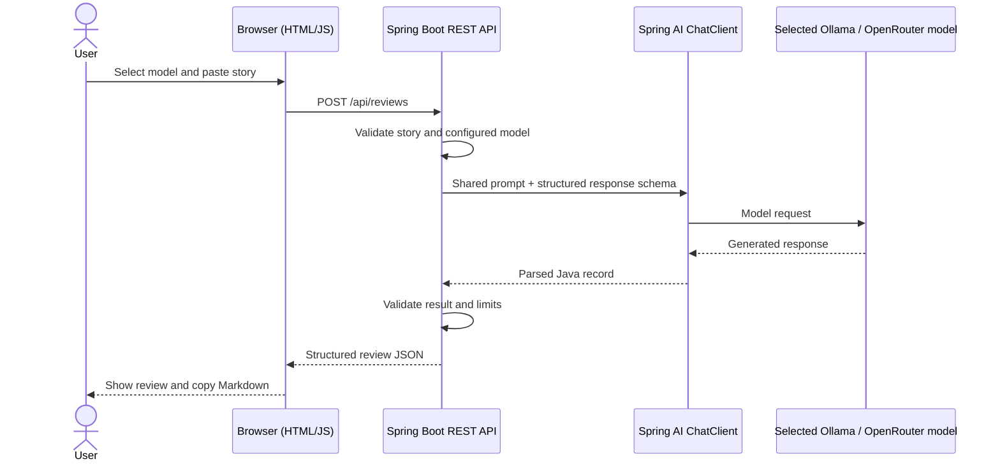
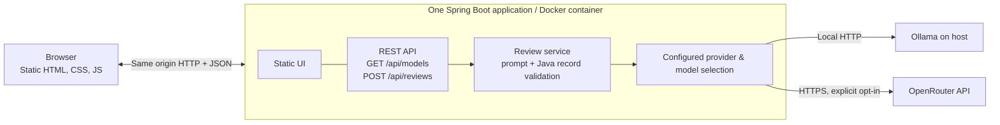

# StoryCheck AI

> **Turn a user story into a clearer, testable starting point.**

[](LICENSE)


**StoryCheck AI** is a small, self-hosted **user story review demo** built with Java, Spring Boot, and Spring AI. Paste a story, explicitly choose a configured Ollama or OpenRouter model, and request suggestions for **acceptance criteria**, **clarification questions**, and **test cases**. Read the review on one page and copy it as Markdown.

> **Repository status: Release 0.1 implemented and verified locally.** STC-001–004 provide the responsive review UI, Markdown copy with manual fallback, health/model/review APIs, shared JSON Schema and validated Java record. Maven tests, local provider stubs, Docker startup and Chromium flows use fixed synthetic data. **Live Ollama/OpenRouter compatibility remains untested.** The GitHub Actions workflow is configured; a hosted run and public deployment have not been verified. See [verification](docs/releases/release-0.1-mvp/verification.md) for the exact evidence and limits.

## Release 0.1 features

- **One-page review:** paste a user story or concise requirement; view a structured review and copy Markdown.
- **Explicit model selection:** at most **three Ollama** and **three OpenRouter** models configured in `.env`; blank slots are hidden.
- **Two AI providers:** host-installed Ollama by default, optional OpenRouter via a server-side API key; never silently fall back to a paid provider.
- **Structured output:** the same Java record/JSON response contract for either provider, validated before returning it to the browser.
- **Small deployment:** one Spring Boot application serves the HTML/CSS/JavaScript UI and REST API; no separate frontend build, database, or application-side agent framework.

## User journey

1. Open the StoryCheck AI page.
2. Select one of the configured models (Ollama or OpenRouter).
3. Paste a story, then click **Analyze Story**.
4. Read the proposed acceptance criteria, clarification questions, test cases and brief feedback.
5. Use **Copy Markdown** to paste the result into a ticket or repository story. Nothing is saved automatically.



## Architecture



No database or shared Docker volume is needed. Ollama remains outside Compose; OpenRouter is a cloud API and may charge for usage. The user's story is sent to the **selected** model provider: use fictional or non-confidential material when testing external models.

More detail: [Architecture](docs/architecture.md) · [API contract](docs/api-contract.md) · [Model configuration](docs/model-configuration.md).

## Technology versions and target stack

| Layer | Technology |
| --- | --- |
| Application | Java 21, Spring Boot 4.1.1, Spring Web MVC |
| AI integration | Spring AI 2.0.1 `ChatClient`, Ollama and OpenAI-compatible OpenRouter adapters |
| Output | Java review records, provider-native JSON Schema, strict parsing and server-side validation |
| UI | HTML5, CSS3, Vanilla JavaScript (`src/main/resources/static/`) |
| Build & tests | Maven 3.6.3+ (3.x), JUnit Jupiter, Spring MockMvc; Docker build uses Maven 3.9.16 |
| Packaging | Docker, Docker Compose (one app service; external AI providers) |
| Quality | GitHub Actions Maven verification with fixed provider fixtures; optional Chromium checks |

`pom.xml` pins Java 21, Spring Boot 4.1.1 and the Spring AI 2.0.1 BOM. The [official compatibility guide](https://docs.spring.io/spring-ai/reference/getting-started.html) supports Spring AI 2.0.x with Boot 4.0.x/4.1.x; [Boot requirements](https://docs.spring.io/spring-boot/4.1/system-requirements.html) include Java 21 and Maven 3.6.3+. Maven Enforcer requires a Java 21 JDK and Maven 3.x. Provider modules are configured directly so missing OpenRouter credentials do not trigger failing auto-configuration. Compatibility of structured output remains model-dependent; no live model has been tested.

The Maven coordinates are `net.kereszteszsolt:story-check-ai`; Java sources and tests use the `net.kereszteszsolt.storycheck` package.

## Server-side model configuration

The example configuration exposes only non-empty allowlisted model slots:

```dotenv
OLLAMA_BASE_URL=http://host.docker.internal:11434
OLLAMA_MODEL_1=qwen2.5:7b
OLLAMA_MODEL_2=llama3.2:3b
OLLAMA_MODEL_3=

OPENROUTER_API_KEY=
OPENROUTER_MODEL_1=
OPENROUTER_MODEL_2=
OPENROUTER_MODEL_3=
```

These are **example model identifiers, not automatically installed models**. Set Ollama model names to models already pulled on your host. Enable OpenRouter only by providing a server-side API key and one or more compatible model IDs. The UI never receives the key. Model names are backend-validated; arbitrary client-supplied model IDs and automatic cloud fallback are not allowed.

Copy `.env.example` to `.env` for Compose. The backend reads the configured URLs, model slots, OpenRouter key and `AI_REQUEST_TIMEOUT_MS`. Blank slots are hidden, surrounding whitespace is trimmed, and duplicate IDs are removed within each provider. `GET /api/models` returns only `provider`, `model` and `label`; a blank cloud key hides all OpenRouter choices. Startup, health and model listing never call either provider. See [Model configuration](docs/model-configuration.md) for limits and failure categories.

## Local startup

The foundation needs no model, Ollama installation or API key. Choose a Java 21 JDK with Maven 3.6.3+ (3.x), or Docker Engine/Desktop with Compose v2+. Docker builds need network access to Maven Central and the Maven/Temurin image registries.

Native development:

```bash
mvn -B -ntp verify
mvn spring-boot:run
# Or, after stopping the development process:
java -jar target/story-check-ai.jar
```

The native app binds to `127.0.0.1:8080`. Set an environment variable such as `APP_PORT=8081` to change its port. Native Maven/Java startup reads process environment variables; it does not automatically load `.env`.

Docker Compose:

```bash
cp .env.example .env
# Configure installed model slots; leave OpenRouter credentials blank if unused.
docker compose config --quiet
docker compose up --build
```

Open `http://localhost:33070` (or your `APP_PORT`) for the Docker review page; native Java startup uses `http://localhost:8080`. With no configured models, the page explains how to enable choices and disables submission. Choose a model explicitly, enter 10–4,000 characters and click **Analyze Story**. **Copy Markdown** copies the displayed review; if clipboard access is unavailable, the page selects a read-only Markdown field for manual copying. Editing the story or changing the model clears the prior result. Nothing is saved by the app.

`curl --fail http://localhost:33070/api/health` returns `{"status":"ok"}` without contacting a provider. Use `docker compose down` to stop the stack. The container runs as a non-root user; Compose publishes its fixed internal port 8080 only on `127.0.0.1`. `.dockerignore` allows only the Maven project, source, branding catalog/artwork and license into the build context, excluding `.env` and repository metadata.

Ollama remains host-installed and outside Compose. Its default endpoint is `http://localhost:11434` for native development and `http://host.docker.internal:11434` from Docker. Compose includes the Linux `host-gateway` mapping, but a host Ollama bound only to loopback may still be unreachable from a Linux bridge. Any host bind/firewall adjustment requires separate configuration; live host connectivity remains untested. No models are downloaded automatically.

The API returns safe JSON errors (`code`, `message`). Requests deserialized through `@RequestBody` have a 65,536-byte limit. `POST /api/reviews` accepts exactly `provider`, `model` and a nonblank 10–4,000-character `story`. It returns `summary`, `acceptanceCriteria`, `clarificationQuestions` (possibly empty) and `suggestedTests`, with strict field/list bounds. The provider gateway validates the exact configured selection, uses bounded timeouts (1,000–120,000 ms), and makes no automatic retries or provider fallback. The browser shows loading/error states, prevents duplicate submission while a request is pending, and renders model text literally. See the [API contract](docs/api-contract.md) and [testing guide](docs/testing.md).

## Branding and About

[`brand/branding.json`](brand/branding.json) owns displayed app and author names, the description, links and artwork paths. Maven packages the JSON and existing poster plus the matching SVG icon/favicon from `brand/assets/` into the Spring Boot application. Rebuild the app or Docker image after changing them. The footer shows the current-year author copyright with an inline license link and the author's website domain as a direct link.

The header's **About** button opens a native dialog with the large StoryCheck poster, description and filled project/author link buttons. **Buy me a Coffee** and **Ways to support** sit together, followed by the voluntary-support note and copyright. A dimmed, blurred backdrop keeps the dialog in focus. Speech-bubble tooltips appear on hover or keyboard focus, explain each destination and show the full URL; website/support tooltips also list hu | en | ro | de. Escape dismisses a visible tooltip before closing About; closing About returns focus to its button and preserves the story draft, model selection and review. See the [branding guide](brand/README.md).

## Development workflow

The repo uses lightweight **story-driven AI-assisted development**. Read [AGENTS.md](AGENTS.md) and [Story workflow](docs/story-workflow.md), then implement **one approved** story at a time. Codex configuration has one **optional** `implementation_worker` and two technology-specific skills; no default parallel agents.

| Guide | Purpose |
| --- | --- |
| [Architecture](docs/architecture.md) | Boundaries and Mermaid diagrams |
| [API contract](docs/api-contract.md) | Implemented endpoints, request/response bounds and safe errors |
| [Model configuration](docs/model-configuration.md) | Environment variables, provider selection, secrets |
| [Testing](docs/testing.md) | Focused checks and approved real-model smoke tests |
| [Roadmap](docs/roadmap.md) | Release status and story links |
| [Release 0.1](docs/releases/release-0.1-mvp/README.md) | STC-001–004 and acceptance criteria |
| [Verification](docs/releases/release-0.1-mvp/verification.md) | Actual commands, results and untested runtime boundaries |
| [Future ideas](docs/future.md) | Optional possibilities, not planned stories |
| [Codex roles & skills](.codex/README.md) | Minimal agent/skill selection |

## License

Apache-2.0. Copyright © 2026 **Keresztes Zsolt** — [kereszteszsolt.hu](https://kereszteszsolt.hu).

New hand-written source files use the short, two-line SPDX header defined in [AGENTS.md](AGENTS.md). See the full [LICENSE](LICENSE).

## Contact

**Project maintainer: Keresztes Zsolt**

| Platform | Link |
| --- | --- |
| Website | [kereszteszsolt.hu](https://kereszteszsolt.hu/) |
| GitHub | [@kereszteszsolt](https://github.com/kereszteszsolt) |

> The maintainer's website is available in Hungarian (HU), English (EN), Romanian (RO), and German (DE).

## ☕ Ways to support

**Explore ways to support the maintainer and their projects.**

[https://kereszteszsolt.hu/ways-to-support](https://kereszteszsolt.hu/ways-to-support)

<p align="center">
  <a href="https://buymeacoffee.com/kereszteszsolt"></a><br>
  <strong>Every coffee counts! ☕❤️</strong>
</p>

---

<p align="center">
  <strong>Made with ❤️ by <a href="https://kereszteszsolt.hu/">Keresztes Zsolt</a></strong><br>
  ⭐ Star this repository if you find it useful!
</p>
