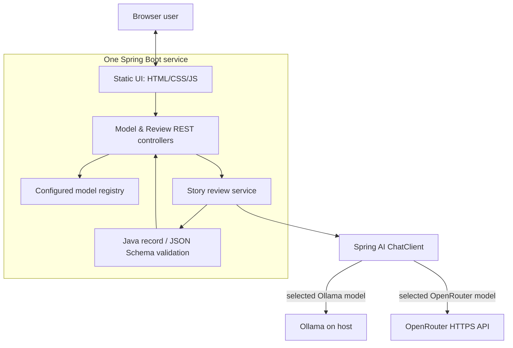

# Architecture — planned Release 0.1

**Status: Planned.** This is the target structure for one small Spring Boot application, not a description of implemented files.

## Runtime boundaries

- **Browser:** receives a list of configured non-empty model choices; sends a user story and explicit selected provider/model; renders a validated review and copies Markdown. Never receives secrets.
- **Spring Boot:** serves the UI and same-origin `/api` routes. HTTP input limits and provider/model allowlisting are enforced here.
- **Spring AI:** prepares a shared prompt and obtains a typed output using `ChatClient`, with provider-specific adapters isolated from the review contract.
- **Ollama:** runs separately on the developer machine; no Ollama container, model volume or public listener is required.
- **OpenRouter:** optional outbound HTTPS request only when explicitly selected. The server owns the API key and handles errors/rate limits.
- **Storage:** none. The app keeps no server-side conversations, story history, user accounts, or saved reviews.

## Target flow

1. `GET /api/models` exposes configured allowlisted model labels and opaque selectors, not keys or unrestricted model routing.
2. `POST /api/reviews` receives the story and selected model; the API validates the request.
3. The review service builds one prompt that asks for concise feedback, acceptance criteria, missing details and test cases.
4. Spring AI calls only the selected provider. The output is parsed into the shared Java record contract.
5. The server checks schema and domain limits; returns structured JSON or a safe, actionable error. No review is persisted.
6. The browser renders each field as text and builds the copied Markdown locally.

## Deployment

After STC-001, Compose will build a **single** Spring Boot container and publish only the web port to `127.0.0.1` by default. An optional `host.docker.internal`/`host-gateway` mapping will be needed on some Linux installations to reach host-installed Ollama. Avoid publicly exposing the Ollama port. Native Spring Boot development can point at host `localhost:11434` instead.

No `db`, `web`, `worker`, scheduler, or LLM container and no named volumes are planned.

## Non-goals

No RAG, embeddings, agent framework, MCP, authentication, multi-user collaboration, file uploads, AI code execution, persistent job queue, or prompt-history database. See [Future ideas](future.md) only for uncommitted possibilities.

Related: [API contract](api-contract.md) · [Model configuration](model-configuration.md) · [Release 0.1](releases/release-0.1-mvp/README.md).
